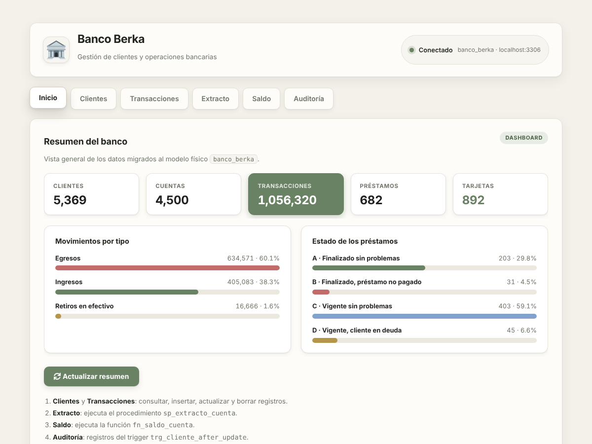

# Berka Data Base

Database design for managing bank customers, their accounts and the financial operations performed on them.

**Authors:** Juan Felipe Molano Vega, Juan Pablo Castaño Morales

## Brief description

This project models a relational database for a bank. It stores customers, the accounts they hold, the transactions made on those accounts, standing payment orders, loans and issued cards. It also stores demographic data for each district, so financial behavior can be analyzed against the characteristics of the area where customers and branches are located.

## Preview



The home tab of the interface (in Spanish) shows the totals of the model, the movements by type and the status of the loans. It is shown here with the full dataset loaded.

## Data source

The data comes from the **Berka dataset**, a real anonymized sample of a Czech bank (clients, accounts, transactions, loans, cards and district demographics), published on Kaggle:

<https://www.kaggle.com/datasets/marceloventura/the-berka-dataset/data>

It is loaded as is from `data/berka.sql.gz` (8 tables, 1,056,320 transactions) into a staging database and then migrated to the corrected physical model. Check the license and terms on the Kaggle page before reusing or redistributing the data.

## Context

A bank needs a database to administer the information about its customers, their accounts and the financial operations carried out on them. The data is organized around the following entities.

- **Customer:** identifier, date of birth, gender and district of residence.
- **District:** name, region, population, number of municipalities, degree of urbanization, average salary, unemployment rate and number of entrepreneurs. It complements customer and account data with demographic information.
- **Account:** identifier, opening date, district of the branch and the frequency of its account statements.
- **Disposition:** the link between a customer and an account. A customer can have several accounts and an account can be used by several customers. The disposition states whether the customer is the **owner** or only an **authorized user**.
- **Transaction:** date, type of movement, operation performed, amount and resulting balance. When applicable, it also records the counterparty bank and account. An account can have many transactions, which gives its history and balance evolution.
- **Payment order (standing order):** originating account, destination bank and account, amount sent and the type or purpose of the payment. An account can have several orders.
- **Loan:** grant date, amount, duration, periodic installment and status. An account has at most one loan. The status distinguishes four cases:
  - finished without problems,
  - finished with payment problems,
  - running with no issues,
  - running with the customer in debt.
- **Card:** identifier, type and issue date. Each card is tied to a disposition, so it identifies both the account it can operate on and the customer entitled to use it.

## What the database should answer

- Which accounts belong to each customer.
- Who is authorized to operate each account.
- Which cards have been issued.
- The transaction history of an account.
- The standing payment orders of an account.
- The loans granted.
- How financial behavior relates to district demographics.

## Project structure

```
berka_data_base/
├── config/
│   ├── config.example.toml   # template with every setting (committed)
│   └── config.toml           # your local copy with the password (ignored by git)
├── data/
│   └── berka.sql.gz          # original dataset (compressed)
├── docs/
│   ├── Diccionario_de_datos.docx
│   ├── sql_Entrega2_documentado.mwb
│   └── images/inicio.png     # screenshot used in this README
├── notebooks/
│   └── Tercera_Entrega_Berka.ipynb   # step-by-step report of the third delivery
├── sql/
│   └── berka_objects.sql     # routines over the raw schema (Workbench / mysql console)
└── src/berka_bank/
    ├── main.py               # orchestrator: `uv run berka`
    ├── config.py             # reads config/config.toml
    ├── db.py                 # connection, execute/query, MySQL error messages
    ├── staging.py            # 1. load berka.sql into `berka`
    ├── schema.py             # 2. physical model `banco_berka` (DDL)
    ├── migration.py          # 3. staging -> model + validation against the dictionary
    ├── routines.py           # 4. fn_saldo_cuenta, sp_extracto_cuenta, vw_resumen_cuenta, triggers
    └── ui/                   # ipywidgets interface (Spanish), served with Voilà
        ├── app.py            # header, tabs and page assembly
        ├── theme.py          # CSS theme
        ├── widgets.py        # form fields, tables, KPI tiles, bars
        ├── home.py           # "Inicio" dashboard
        ├── clients.py        # CRUD on Cliente
        ├── transactions.py   # CRUD on Transacciones
        └── routines.py       # procedure, function, view and audit trigger tabs
```

## Getting started

Requirements: MySQL 8.0.16+ running, and [uv](https://docs.astral.sh/uv/).

```bash
git clone https://github.com/jpcastanom/berka_data_base.git
cd berka_data_base
uv sync                                           # creates .venv and installs everything
cp config/config.example.toml config/config.toml  # then edit user/password
uv run berka
```

`uv run berka` runs the whole pipeline and then opens the interface at <http://localhost:8866>:

1. **Staging**: loads `data/berka.sql.gz` into the `berka` database (1-3 min, only the first time).
2. **Model**: creates `banco_berka` and migrates the data (about 1 min, only if it does not exist yet).
3. **Routines**: recreates the function, the procedure, the view and both triggers.
4. **Interface**: serves the app (tabs Inicio, Clientes, Transacciones, Extracto, Saldo, Resumen, Auditoría).

Later runs skip steps 1 and 2, so the changes made from the interface are kept.

| Command | What it does |
|---|---|
| `uv run berka` | prepare what is missing and open the interface |
| `uv run berka --rebuild` | drop and rebuild `banco_berka` from staging |
| `uv run berka --reload-staging` | load `berka.sql` again |
| `uv run berka --setup-only` | prepare the database without opening the interface |
| `uv run berka --port 9000 --no-browser` | change port / do not open the browser |

If `password` is empty in `config.toml`, it is read from the `MYSQL_PASSWORD` environment variable, or asked once at startup.

To open the report notebook: `uv run jupyter lab notebooks/Tercera_Entrega_Berka.ipynb`. It reads the same `config/config.toml`.

### Running from VS Code

Use the **Run and Debug** panel (F5) and pick *Berka: preparar BD y abrir interfaz*. Do not use the "Run Python File" button: with spaces or accents in the folder path it wraps the path in extra quotes and Python cannot find the file. From a terminal, always use `uv run berka` at the project root.
